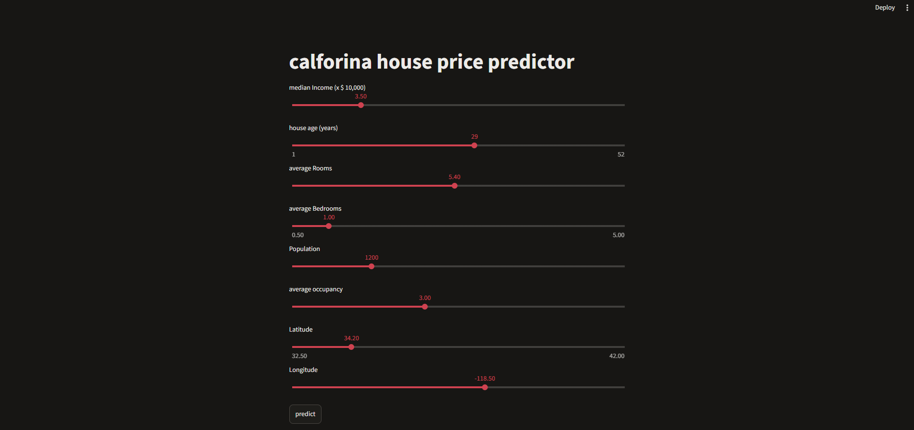

# AI learning journey : breast cancer prediction 

machine learning projects bulit with python and scikit-learn while learning ai/ml from scratch.

## main projects: breast cancer prediction 
-dataset: breast cancer wisconsin (569 patients ,30 features)
-model cmpared: logostic regression , knn , decision tree
-evalution: 5-fold cross-validation,cofusion matrix,precision ,recall
-saved the best model using joblib
-built a streamlit web app to predict from user inputs

## results
| Model | CV Accuracy | Malignant Recall (CV) |
|-------|-------------|-----------------------|
| Logistic Regression | 0.981 | 0.962 |
| Decision Tree | 0.919 | 0.887 |
| KNN | 0.965 | - |

logistic regression was best. it missed fewer cancer patients (fn 1 vs 4 for the tree on the test split ).

## skills used
python , numpy , pandas , Matplotlib , scikit-learn , pipelines , streamlit , git/github

## How to Run
pip install -r requirements.txt
pyhton -m streamlit run app.py

## Project 2: California House Price Predictor

- Dataset: California housing (sklearn), 20,640 rows, 8 features
- Model: Random Forest Regressor, tuned with GridSearchCV (max_depth 20, n_estimators 100, min_samples_leaf 1)
- Test R2: 0.805
- Most important feature: MedInc (median income)
- Streamlit app (app_house.py): 8 sliders, predicts house price in dollars

### How to run
1. Run `python day19_save.py` first (creates house_model.pkl; the model file is not uploaded because it is in .gitignore)
2. Run `python -m streamlit run app_house.py`

### App Screenshot
